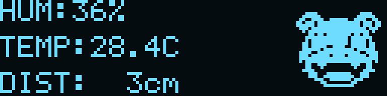
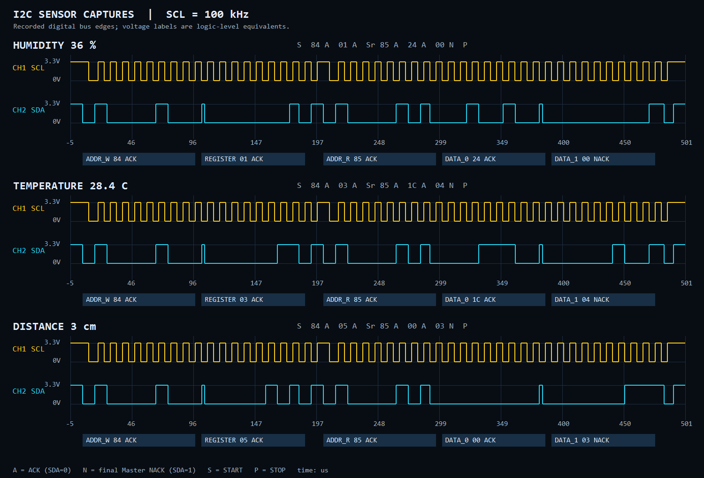

# FPGA_I2C — Basys3 I2C 센서 모니터링

Basys3 두 대를 I2C로 연결해 Slave의 온습도·거리 측정값을 Master의 FND, UART, SSD1306 OLED에 표시한 Verilog RTL 프로젝트입니다. 기본 100ms 간격으로 데이터를 읽고, BTNU로 FND의 온습도·거리 표시를 전환합니다.

[← 포트폴리오](../README.md) · [팀 프로젝트 저장소](https://github.com/Kyuhyeon34/FPGA_I2C_Sensor_Monitor)

## 동작 영상

Slave에 연결한 센서값을 Master가 수신해 표시하는 실제 보드 시연입니다. 두 보드의 FND와 OLED 출력, 온습도·거리 표시 전환을 확인할 수 있습니다.

## OLED 소수점 표시 (시뮬레이션)

온도 소수 바이트를 받아 TEMP:28.4C로 표시합니다. 실제 보드에서는 Slave가 제공하는 값을 사용하며, 소수 바이트가 0이면 .0으로 표시합니다.

## 담당 역할

**2인 팀 프로젝트에서 I2C Master를 담당했습니다.** Slave의 센서 드라이버와 레지스터 규약에 맞춰 읽기 프로토콜, 수신값 검증, 자동 갱신과 표시 회로를 구현했습니다.

| 구분 | 담당 및 구현 |
|---|---|
| 개인 담당 — Master | I2C Master FSM, repeated START·8바이트 burst read, 100ms 자동 수신, ID/상태 검사, 거리 BCD 변환, OLED·FND·UART 출력, 테스트벤치와 빌드 검증 |
| 팀원 담당 — Slave | DHT11·HC-SR04 센서 제어, START 스냅샷 레지스터, I2C Slave FSM, Slave 로컬 FND·UART |
| 이 폴더의 코드 | 담당한 Master RTL과 테스트·핀 제약·빌드 스크립트. 실제 Slave의 I2C/레지스터 RTL 두 파일은 통합 시뮬레이션에만 사용 |

## 기술 스택

| 항목 | 내용 |
|---|---|
| 보드 / FPGA | Basys3 × 2 / Artix-7 `xc7a35tcpg236-1` |
| 언어 / 도구 | Verilog HDL, SystemVerilog 테스트벤치 / Vivado 2020.2, XSim |
| 시스템 클럭 / I2C | 100MHz / 약 100kHz, SDA·SCL은 0 또는 Z로 구동 |
| 센서 / 주소 | DHT11, HC-SR04 / Slave `0x42`, OLED `0x3C` |
| 출력 | 4자리 FND, UART 9600 baud·8N1, SSD1306 128×32 OLED |
| 핵심 설계 | FSM, burst read, 공유 버스 중재, 순차 BCD 변환, 디바운싱 |

## 주요 기능과 조작

| 기능 / 입력 | 동작 |
|---|---|
| 자동 수신 | 전원·리셋 직후 첫 읽기, 이후 기본 100ms 간격 센서 읽기 |
| BTNC | 센서 레지스터 추가 읽기 요청 |
| BTNU | 누를 때마다 Master FND의 온습도 ↔ 거리(cm) 표시 전환 |
| 온습도 FND | `47.27` = 습도 47%, 온도 27°C |
| 거리 FND | `0300` = 300cm, 소수점 OFF. 9999cm 초과는 `9999`로 제한 |
| OLED | HUM / TEMP / DIST 세 줄과 오른쪽 32×32 야돈 애니메이션 |
| UART | 온습도 정수, 16비트 거리와 원본 레지스터 8바이트 출력 |
| 오류 처리 | NACK·타임아웃·ID·센서 유효 상태 검사, 마지막 정상값 유지 및 다음 주기 재시도 |
| SW15 | ON으로 리셋, OFF로 실행. 리셋 시 온습도 모드로 시작 |

BTNU에는 10ms 디바운싱과 한 번 누름 검출을 적용했습니다. 길게 눌러도 한 번만 전환하며 I2C 수신·OLED 전송·UART 출력 중에도 표시 모드를 바꿀 수 있습니다. 두 모드의 데이터는 계속 갱신하므로 전환 즉시 마지막 정상값을 표시합니다.

100ms는 Master의 요청 간격입니다. 실제 측정값의 변화는 Slave의 센서 측정 주기에 따르며, I2C/UART 처리 중 도래한 요청은 완료까지 기다립니다. 첫 정상 거리 수신 전 FND는 `0000`을 표시합니다.

## 시스템 구조

~~~mermaid
flowchart LR
    DHT["DHT11 온습도"] --> REGS["Slave 스냅샷 레지스터"]
    US["HC-SR04 거리"] --> REGS
    REGS --> SLAVE["I2C Slave 0x42"]
    SLAVE <--> BUS["공유 SDA / SCL"]
    OLED["SSD1306 OLED 0x3C"] <--> BUS
    BUS <--> MASTER["I2C Master FSM"]
    POLL["100ms 자동 읽기 / BTNC"] --> ARB["센서·OLED 요청 중재"]
    ARB --> MASTER
    MASTER --> VALID["ID / 센서별 STATUS 검사"]
    VALID --> BCD["16클럭 거리 BCD 변환"]
    BCD --> FND["FND 온습도 / 거리"]
    BCD --> UART["UART 9600"]
    BCD --> DRAW["OLED 화면 생성"]
    DRAW --> ARB
    BTNU["BTNU 디바운싱"] --> FND
~~~

센서 읽기는 8바이트를 한 번에 완료하고, OLED는 바이트 전송 경계에서 센서 요청에 우선권을 넘깁니다. 하나의 I2C 코어를 공유해 두 요청이 같은 선을 동시에 구동하지 않도록 했습니다. OLED 오류와 센서 통신 오류는 별도로 관리합니다.

## 구현 내용

### 레지스터 포인터와 repeated START

매 읽기마다 포인터를 `0x00`으로 다시 지정한 뒤 repeated START로 수신을 시작합니다. Slave의 이전 읽기가 어느 주소에서 끝났는지에 영향을 받지 않습니다.

~~~text
START → 0x84 → ACK → 0x00 → ACK
      → repeated START → 0x85 → ACK
      → ID → H_INT → H_DEC → T_INT → T_DEC → DIST_H → DIST_L → STATUS
      → STOP
~~~

수신 1~7바이트에는 ACK, 마지막 STATUS에는 NACK를 보냅니다. 정상 종료를 위한 마지막 NACK는 통신 오류와 구분합니다.

| 레지스터 | 내용 |
|---|---|
| `0x00` | WHO_AM_I = `0xA5` |
| `0x01 / 0x02` | 습도 정수 / 소수 |
| `0x03 / 0x04` | 온도 정수 / 소수 |
| `0x05 / 0x06` | 거리 상위 / 하위 바이트, cm |
| `0x07` | bit0: 온습도 유효, bit1: 거리 유효 |

### 수신 완료와 표시 갱신 분리

8바이트 수신이 끝난 뒤 ID와 센서별 유효 비트를 검사합니다. 온습도가 무효여도 거리가 유효하면 거리 표시를 갱신하고, 각 표시에는 마지막 정상값을 유지합니다. 전송이 중단된 불완전한 프레임은 표시값에 반영하지 않습니다.

OLED는 화면 한 장을 같은 데이터로 그리고, 그리는 중 새 값이 들어오면 다음 화면에 최신값을 반영합니다. UART도 한 줄의 스냅샷을 유지하고 출력을 마친 뒤 다음 센서 읽기를 허용해 로그가 섞이지 않게 했습니다.

~~~text
H=047 T=027 D=00007cm RX=A5 2F 00 1B 07 00 07 03
~~~

### 순차 BCD 변환과 출력

거리 상·하위 바이트를 16비트 cm 값으로 합친 뒤, double dabble 방식의 add-3/shift 연산을 16클럭에 나누어 수행합니다. 완성된 다섯 자리 BCD를 FND·UART·OLED가 사용하며, 각 표시 장치의 자릿수에 맞춰 범위를 제한합니다.

| 출력 | 표시 범위 |
|---|---|
| UART | 0~65535cm, 다섯 자리 |
| FND 거리 모드 | 0~9999cm, 네 자리 |
| OLED | 0~999cm, 세 자리 |

SSD1306 초기화, 문자 생성과 화면 RAM 전송을 RTL로 구현했습니다. 오른쪽 캐릭터는 네 프레임의 ROM을 사용하며 약 0.5초마다 오른쪽 128바이트만 갱신합니다. 센서값이 들어오면 문자 영역을 포함한 전체 화면을 갱신합니다.

## 문제 해결

| 문제 | 원인 | 해결 |
|---|---|---|
| 온습도·거리가 섞이거나 반복 읽기 위치가 밀림 | 바이트 의미와 자동 증가 포인터를 맞추지 못함 | 매번 포인터 0 지정 후 8바이트 burst read, 레지스터 맵에 맞춰 해석 |
| 16비트 거리의 바이트 순서·표시 범위 검증 | 두 바이트로 수신하며 출력 장치마다 자릿수가 다름 | `{DIST_H, DIST_L}`로 복원, 255/256·9999/10000cm 경계와 표시 제한 검사 |
| 거리 십진 변환 경로의 타이밍 위반 | 16비트 조합 나눗셈 경로가 길어짐 | 16클럭 순차 BCD 변환으로 변경하고 최종 배치·배선 타이밍 검사 |
| 수신·UART 출력 중 표시 모드 입력 처리 | 통신 요청과 버튼 처리가 결합됨 | BTNU 모드 플래그를 통신 FSM과 독립적으로 갱신 |
| OLED와 센서가 같은 버스를 사용 | 화면 전송 도중 센서 읽기 요청 발생 | OLED 바이트 경계에서 중재, 센서 burst는 중간에 끊지 않음 |

## 검증 결과

동일 Master RTL로 Vivado XSim의 **시뮬레이션 top 5개를 모두 통과**했습니다. 실제 보드 시연은 위 GIF에, 합성·배치·배선 결과는 [reports/](reports/)에 정리했습니다.

| 테스트 | 검사 내용 |
|---|---|
| [tb_i2c_master](sim/tb_i2c_master.sv) | 읽기/쓰기 16회, 비트 순서, ACK/NACK, clock stretching, busy 요청, 타임아웃·리셋 복구 |
| [tb_top](sim/tb_top.sv) | 실제 Slave RTL 연동, 16회 레지스터 읽기, 스냅샷, BTNU 디바운스·길게 누르기, 실제 FND 숫자·소수점, 9999/10000cm 경계 |
| [tb_oled](sim/tb_oled.sv) | SSD1306 초기화·화면 RAM, 문자·4프레임 ROM, 부분 갱신, 센서별 유효성, OLED 연결 실패·복구 |
| [tb_top_polling](sim/tb_top_polling.sv) | 100ms 자동 수신, OLED/UART 중 BTNU 전환, FND 자동 갱신, NACK·타임아웃 후 재시도 |
| [tb_top_polling_fast](sim/tb_top_polling.sv) | UART보다 짧은 주기에서 요청 대기·스냅샷 일관성·오류 복구 |

| 최종 Master 구현 | 결과 |
|---|---|
| Slice LUT / FF | 997 / 615 |
| Setup WNS / Hold WHS | +0.069ns / +0.122ns |
| 타이밍·DRC | Setup/Hold 위반 없음, DRC 위반 0건 |

보고서: [타이밍](reports/timing_summary.txt) · [자원 사용량](reports/utilization.txt) · [DRC](reports/drc.txt)

## 코드 구성

| 파일 / 폴더 | 역할 |
|---|---|
| [src/top.v](src/top.v) | 자동 읽기, 버스 중재, 수신 검증, BTNU 표시 선택과 출력 연동 |
| [src/i2c_master.v](src/i2c_master.v) | open-drain SDA/SCL, repeated START, burst read, ACK/NACK·타임아웃 |
| [src/binary_to_bcd16.v](src/binary_to_bcd16.v) | 16비트 거리의 순차 BCD 변환 |
| [src/ssd1306_oled.v](src/ssd1306_oled.v) | OLED 초기화, 문자·거리·애니메이션과 화면 전송 요청 |
| [src/button_pulse.v](src/button_pulse.v) | 버튼 동기화·디바운싱·단일 펄스 |
| [src/fnd_display.v](src/fnd_display.v) | 네 자리 FND 스캔, 숫자와 소수점 출력 |
| [src/uart_tx.v](src/uart_tx.v) | UART 9600 baud·8N1 송신 |
| [sim/](sim/) | 테스트벤치 5개 파일, 실제 Slave 참조 RTL, 실행·화면 복원 스크립트 |
| [constr/Basys3_master.xdc](constr/Basys3_master.xdc) | Basys3 클럭·버튼·FND·UART·JA1/JA2 핀 제약 |
| [create_project.tcl](create_project.tcl) | 저장 위치를 기준으로 Vivado 프로젝트 생성 |
| [scripts/build_bitstream.tcl](scripts/build_bitstream.tcl) | 합성·구현·비트스트림 생성과 타이밍·DRC 검사 |

## 센서별 파형 실습

[파형 그림](assets/i2c_scope.png) · [파형 미리보기](assets/i2c_scope.html) · [Vivado 실행·해석 안내](sim/I2C_SCOPE_GUIDE.md) · [테스트벤치](sim/tb_i2c_scope.sv)

습도 36%, 온도 28.4°C, 거리 3cm의 SDA/SCL 파형을 관찰할 수 있습니다. 기본 Vivado 화면에는 SCL·SDA·센서값·현재 바이트·통신 단계의 5줄만 표시합니다.

각 센서 레지스터를 2바이트씩 읽으며 주소, repeated START, ACK/NACK와 바이트를 라벨로 표시합니다.
네 가지 실행 모드와 파형 자동 배치·WCFG 저장 검증을 통과했습니다.
시스템 검증용 기존 5개와 별도의 파형 데모이며, 보드용 8바이트 전체 읽기는 그대로입니다.

## 실행 방법

포트폴리오 저장소 루트에서 실행합니다.

~~~powershell
powershell -ExecutionPolicy Bypass -File FPGA_I2C/sim/run_sim.ps1
vivado -mode batch -source FPGA_I2C/scripts/build_bitstream.tcl
~~~

Vivado GUI에서는 Tcl Console에서 `source FPGA_I2C/create_project.tcl`을 실행합니다. 생성 프로젝트는 `FPGA_I2C/vivado/i2c_master.xpr`, 성공한 비트스트림은 `FPGA_I2C/bitstream/top.bit`입니다.

Master JA1(SDA), JA2(SCL), JA5(GND)를 Slave와 공유하고 OLED도 같은 SDA/SCL에 연결합니다. 센서는 Slave에 연결합니다. Slave 전체 코드와 구성은 [팀 프로젝트 저장소](https://github.com/Kyuhyeon34/FPGA_I2C_Sensor_Monitor)를 참고할 수 있습니다.