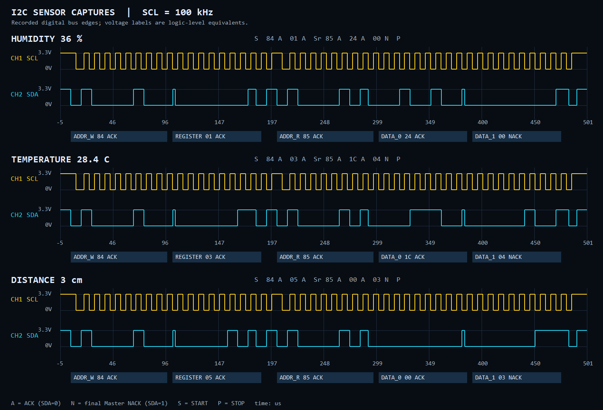

# 온도·습도·거리 I2C 파형 보기

[tb_i2c_scope.sv](tb_i2c_scope.sv)는 실제 I2C Master 코어와 Slave 참조 RTL을 연결하고, 선택 센서의 레지스터 두 바이트만 읽는 시뮬레이션입니다. 보드용 `top.v`와 기존 `tb_i2c_master`는 바꾸지 않습니다.

SCL/SDA의 디지털 신호 순서는 실제 버스와 같지만, 아날로그 상승시간·3.3V 전압·노이즈는 시뮬레이션하지 않습니다. HTML의 전압 눈금은 논리 0/1을 0/3.3V로 환산한 표시입니다.

## 1. 먼저 완성된 파형 보기

[센서별 파형 미리보기 열기](../assets/i2c_scope.html)



HTML을 브라우저로 열고 캡처를 선택합니다. CH1 SCL은 노란색, CH2 SDA는 청록색입니다. `DATA_0`, `DATA_1` 버튼을 누르면 해당 바이트를 확대합니다. 확대 배율과 좌우 이동으로 9번째 클럭의 ACK/NACK도 볼 수 있습니다.

이 화면은 테스트벤치가 기록한 실제 SDA/SCL 전이 CSV로 생성했습니다.

## 2. Vivado에서 자동으로 파형 띄우기

기존 시뮬레이션이 열려 있으면 Close Simulation으로 닫습니다. 현재 여는 프로젝트에 해당하는 명령 하나를 Vivado Tcl Console에서 실행합니다.

원본 `i2c_driver.xpr` 프로젝트:

```tcl
source D:/project/fpga/ai2/i2c_driver/tests/open_i2c_scope.tcl
```

바탕화면 팀 프로젝트:

```tcl
source C:/Users/kccistc/Desktop/FPGA_I2C_Sensor_Monitor/master/sim/open_i2c_scope.tcl
```

포트폴리오 프로젝트:

```tcl
source C:/Users/kccistc/Desktop/pjt_portfolio/FPGA_I2C/sim/open_i2c_scope.tcl
```

다른 프로젝트가 열려 있다면 먼저 Close Project로 닫습니다. 스크립트는 해당 프로젝트를 열거나 생성하고, 전용 `sim_scope` Simulation Set에서 시뮬레이션과 파형 배치를 실행합니다. 기존 `sim_1`의 실행 폴더와 구분됩니다.

실행 후 `I2C_SCOPE` 파형 창에서 **Zoom Fit**으로 전체를 보고, 첫 번째 `HUM_36PCT` 구간인 약 **50~550us**를 확대하세요. 전체 시뮬레이션은 약 2.14ms입니다. SCL 주기는 약 10us이고 한 읽기 패킷은 약 496us입니다.

## 3. 원하는 센서만 실행

위 `source` 명령을 실행하기 전에 `scope_top`을 지정합니다.

```tcl
set scope_top tb_i2c_scope_temp
# 이어서 자신의 프로젝트에 해당하는 source .../open_i2c_scope.tcl 실행
```

| Simulation Top | 파형에 나오는 센서값 |
|---|---|
| `tb_i2c_scope_all` | 습도 36% → 온도 28.4°C → 거리 3cm |
| `tb_i2c_scope_temp` | 온도 28.4°C |
| `tb_i2c_scope_humidity` | 습도 36% |
| `tb_i2c_scope_distance` | 거리 3cm |

다른 모드로 다시 실행할 때는 시뮬레이션을 닫고 `scope_top`을 새로 지정합니다. 전체 순서로 돌아오려면 `set scope_top tb_i2c_scope_all`을 사용합니다. 공통 모듈 `tb_i2c_scope`는 개별 센서 모듈의 하위 계층에 들어갈 수 있으므로, 목록에서는 별도로 추가한 `tb_i2c_scope_all`을 선택합니다.

GUI에서 직접 실행하려면 새 `.sv` 파일을 Simulation Sources에 추가하고, 원하는 모듈을 Set as Top으로 지정한 뒤 Run Behavioral Simulation을 실행합니다. 이후 같은 폴더의 `i2c_scope_wave.tcl`을 Tcl Console에서 `source`하면 채널과 라벨이 자동으로 배치됩니다.

## 4. 파형 읽는 순서

```text
온도 28.4°C: S 84 A 03 A Sr 85 A 1C A 04 N P
습도 36%  : S 84 A 01 A Sr 85 A 24 A 00 N P
거리 3cm  : S 84 A 05 A Sr 85 A 00 A 03 N P
```

| 구간 / 신호 | 해석 |
|---|---|
| `START` | SCL High 중 SDA가 1→0 |
| `ADDR_W` = `84` | 주소 0x42에 쓰기 요청 |
| `REGISTER` = `03 / 01 / 05` | 읽을 레지스터: 온도 / 습도 / 거리 |
| `RESTART` | STOP 없이 다시 START |
| `ADDR_R` = `85` | 주소 0x42에서 읽기 요청 |
| `DATA_0 / DATA_1` | 온도·습도 정수/소수 또는 거리 상위/하위 바이트 |
| `SLAVE_ACK` | 주소·포인터 뒤 9번째 클럭에서 Slave가 SDA를 0으로 응답 |
| `MASTER_ACK` | 첫 데이터 뒤 Master가 SDA를 0으로 응답 |
| `MASTER_NACK` | 마지막 데이터 뒤 Master가 SDA를 1로 둬 읽기 종료. 정상 동작 |
| `STOP` | SCL High 중 SDA가 0→1 |

SCL 상승 시점의 SDA를 MSB부터 8개 읽고, 9번째 클럭을 ACK/NACK로 구분합니다. `byte_number`는 1~5, `bit_number`는 데이터 1~8과 ACK/NACK 9를 표시합니다.

기본 파형 창에는 CH1_SCL, CH2_SDA, SENSOR_VALUE, BUS_BYTE, BUS_PHASE의 다섯 신호만 표시합니다. SENSOR_VALUE에는 HUM_36PCT, TEMP_28.4C, DIST_3CM이 표시됩니다. BUS_BYTE에는 ADDR_W 84, DATA_0 1C 같은 단계와 실제 바이트가 함께 표시됩니다. 오류 플래그와 카운터는 자동 검사용으로 유지하지만 기본 화면에서는 숨겼습니다.

주의: 코어의 `rx_frame`은 첫 수신 바이트를 하위 8비트에 저장합니다. 따라서 거리 3cm의 버스 순서는 `00 03`이지만 `rx_frame`은 `0300`입니다. 온도 28.4°C는 `1C 04`로 전송하고 `rx_frame`은 `041C`입니다.

## 5. 콘솔에서 검증하고 미리보기 다시 생성

원본 프로젝트 폴더의 PowerShell:

```powershell
.\tests\run_sim.ps1 -Tests tb_i2c_scope_all
python tests/render_i2c_scope.py --output assets/i2c_scope.html
```

팀 프로젝트 저장소 루트에서는 `tests` 대신 `master/sim`, `assets` 대신 `master/assets`를 사용합니다. 포트폴리오 저장소 루트에서는 `FPGA_I2C/sim`, `FPGA_I2C/assets`를 사용합니다.

예를 들어 포트폴리오의 온도만 검증하려면:

```powershell
.\FPGA_I2C\sim\run_sim.ps1 -Tests tb_i2c_scope_temp
python FPGA_I2C/sim/render_i2c_scope.py --prefix i2c_scope_temp
```

PowerShell 실행기의 출력은 각 `sim/build` 또는 원본 `tests/build`에 CSV, VCD, WDB, WCFG로 생성됩니다. 렌더러의 기본 HTML도 같은 build 폴더에 생성됩니다. Vivado GUI 출력은 생성 프로젝트의 `.sim/sim_scope/behav/xsim` 경로에 있습니다. 전체 모드 파일 이름은 `i2c_scope`, 개별 모드는 `i2c_scope_temp`, `i2c_scope_humidity`, `i2c_scope_distance`로 시작합니다.

정상 종료 메시지는 `PASS: tb_i2c_scope_all.scope: 3 sensor captures...` 또는 선택 모드의 `1 sensor captures...`입니다. 파형 자동 배치와 WCFG 저장도 실행기가 함께 검사합니다.

## 기존 보드 파형과 비교할 때

이 데모는 OLED 없이 선택 센서만 2바이트씩 읽습니다. 기존 보드용 프로그램은 여전히 `00`부터 ID·온습도·거리·STATUS의 8바이트를 읽고 OLED 전송도 수행합니다. 데모의 센서값은 테스트벤치에 지정한 값이며, 실제 센서의 아날로그 출력을 모델링한 것은 아닙니다.

Vivado 파형 설정 참고: [create_wave_config](https://docs.amd.com/r/2020.2-English/ug835-vivado-tcl-commands/create_wave_config), [add_wave](https://docs.amd.com/r/2025.1-English/ug835-vivado-tcl-commands/add_wave).
