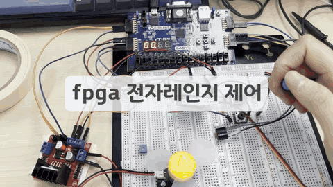
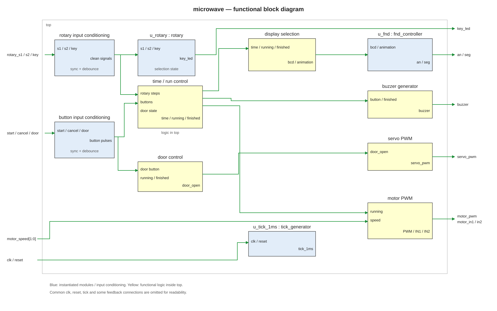
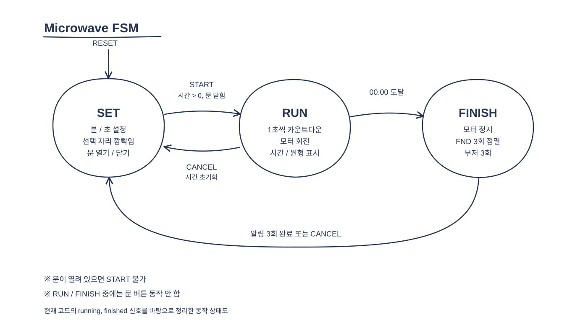
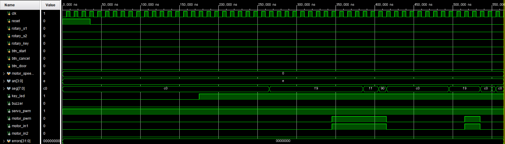

# Microwave — Basys3 FPGA 전자레인지 제어

Basys3와 Verilog HDL로 시간 설정, 카운트다운, 도어 제어 및 모터·부저 출력을 구현한 전자레인지 동작 시뮬레이터

로터리 인코더로 시간을 설정하고, 문이 닫힌 상태에서 조리를 시작하면 남은 시간에 따라 DC 모터와 FND를 제어

[← 포트폴리오](../README.md)

## 동작 영상

[원본 영상 보기 (MP4, 약 17초 · 소리 포함)](./assets/microwave.mp4)

로터리 인코더를 이용한 분·초 설정, 서보 도어 제어, 조리 중 FND 표시·DC 모터 구동, 종료 시 부저 알림 시연

GIF: 무음 미리보기 / MP4: 부저 소리를 포함한 원본 영상

## 기술 스택

| 분류 | 내용 |
|---|---|
| 보드 / FPGA | Basys3 / Artix-7 `xc7a35tcpg236-1` |
| 언어 / 도구 | Verilog HDL / Vivado 2020.2 |
| 클럭 | 100 MHz |
| 입력 | 로터리 인코더, 보드 버튼, 스위치 |
| 출력 | 4자리 FND, 부저, SG90 서보, L298N DC 모터 |
| 핵심 설계 | 입력 동기화·디바운싱, 쿼드러처 회전 검출, 카운트다운, PWM, FND 멀티플렉싱 |

## 주요 기능

| 기능 | 동작 |
|---|---|
| 시간 설정 | 로터리 회전으로 분 또는 초를 0~59 범위에서 증감; 로터리 버튼으로 선택 전환 |
| 설정 표시 | FND에 `MM.SS` 표시, 선택한 두 자리를 0.5초 간격으로 점멸 |
| 시작 / 취소 | 문이 닫히고 시간이 0보다 클 때 시작; 취소 시 시간 초기화 및 모터 정지 |
| 조리 동작 | 1초마다 남은 시간을 감소; FND에 시간과 원형 애니메이션을 1초씩 교대로 표시 |
| 종료 알림 | `00.00` 도달 시 모터 정지, FND 점멸과 부저 3회 후 설정 화면 복귀 |
| 문 제어 | SG90 서보로 열림·닫힘 명령. 조리 및 종료 알림 중 문 버튼 비활성화 |
| 모터 속도 | SW1·SW0에 따라 PWM 듀티 40%, 60%, 80%, 100% 선택 |

## 조작 방법

| 입력 | 동작 |
|---|---|
| SW15 | ON으로 전체 리셋, OFF로 리셋 해제 |
| 로터리 회전 | 선택된 분 또는 초 증감 |
| 로터리 버튼 | 분 ↔ 초 설정 전환; LED0 OFF: 분, ON: 초 |
| BTNC | 문이 닫혀 있고 시간이 0보다 클 때 조리 시작 |
| BTNR | 조리 또는 종료 알림 취소, 시간 초기화 |
| BTNL | 설정 상태에서 문 열기 / 닫기 전환 |
| SW1·SW0 | `00`: 40%, `01`: 60%, `10`: 80%, `11`: 100% PWM |

## 시스템 구조

입력 신호 동기화 및 디바운싱 후 시간 설정·버튼 제어에 사용

시간 및 도어 상태에 따라 FND 표시, 부저, 서보 PWM, DC 모터 PWM을 제어

| 파일 | 역할 |
|---|---|
| [`src/top.v`](src/top.v) | 입력 동기화, 설정·카운트다운, 도어·부저·모터 PWM, 표시 선택 |
| [`src/rotary.v`](src/rotary.v) | 로터리 버튼 선택 상태와 기존 회전 상태 처리 |
| [`src/button_debounce_10ms.v`](src/button_debounce_10ms.v) | 입력 디바운싱 (`debouncer`) |
| [`src/tick_generator.v`](src/tick_generator.v) | 1ms tick 생성 |
| [`src/fnd_controller.v`](src/fnd_controller.v) | 4자리 스캔, 숫자·소수점 및 원형 애니메이션 출력 |
| [`sim/tb_microwave.v`](sim/tb_microwave.v) | 기능별 자동 검사 테스트벤치 |
| [`constraints/Basys3-Master_orginal.xdc`](constraints/Basys3-Master_orginal.xdc) | 보드와 PMOD 핀 제약 |

쿼드러처 전이 검출: `top.v`에서 처리 / 분·초 선택: `rotary.v`의 버튼 토글 출력 사용

### 동작 상태

| 상태 | 동작 및 전이 |
|---|---|
| SET | 분·초 설정 및 문 제어; 시간이 0보다 크고 문이 닫혀 있을 때 START → RUN |
| RUN | 카운트다운과 모터 구동; 0 도달 → FINISH, CANCEL → SET |
| FINISH | 모터 정지 및 3회 알림; 알림 완료 또는 CANCEL → SET |

상태도: `running`·`finished` 플래그 기반 동작 표현 / 도어 상태: 별도 저장값으로 관리

물리 도어 센서 미사용으로 서보 명령 상태를 기준으로 조리 시작 제한

### PWM 및 시간 제어

- 서보: 20ms 주기(50Hz), 닫힘 1ms / 열림 2ms 펄스
- DC 모터: 100MHz 기준 5,000클럭 주기(20kHz), 듀티 4단계, `running = 0` 시 ENA PWM 비활성화
- 부저: 약 2kHz 신호, 버튼 입력 시 100ms 출력, 종료 시 FND 알림과 함께 3회 출력
- FND: 1ms tick 기반 자리 스캔, 설정 중 선택 자리 0.5초 간격 점멸, RUN 중 시간·원형 표시 1초 간격 전환

## 하드웨어 핀맵

| 신호 | Basys3 / 연결 대상 | 역할 |
|---|---|---|
| `clk`, `reset` | W5, R2 (SW15) | 100MHz 클럭, active-high 리셋 |
| `rotary_s1`, `rotary_s2`, `rotary_key` | JC2 M18, JC3 N17, JC4 P18 | 로터리 입력 |
| `btn_start`, `btn_cancel`, `btn_door` | U18 BTNC, T17 BTNR, W19 BTNL | 시작, 취소, 문 제어 |
| `motor_speed[0:1]` | V17 SW0, V16 SW1 | DC 모터 속도 선택 |
| `key_led` | U16 LED0 | 분·초 선택 표시 |
| `buzzer` | JC1 K17 | 부저 신호 |
| `servo_pwm` | JC7 L17 | SG90 신호 |
| `motor_pwm`, `motor_in1`, `motor_in2` | JA1 J1, JA2 L2, JA3 J2 | L298N ENA, IN1, IN2 |
| `seg[0:7]` | W7, W6, U8, V8, U5, V5, U7, V7 | FND a~g, dp |
| `an[0:3]` | U2, U4, V4, W4 | FND 자리 선택 |

## 검증 결과

Vivado XSim에서 [`tb_microwave.v`](sim/tb_microwave.v) 실행 결과: **18개 검사 항목 통과**, `ALL TESTS PASSED` 확인

검사 항목: 초기화, 0초 시작 차단, 로터리 분·초 설정, 도어 시작 제한, 카운트다운·분 자리 내림, 취소 시 모터 정지, 종료 상태 및 알림 구간

### 파형 분석

| 시점 | 주요 신호 | 동작 |
|---|---|---|
| 0~36ns | `reset`: 1 → 0 | 시간 및 제어 상태 초기화 |
| 175~265ns | `key_led = 1`, `seg = 0xF9` | 초 설정 모드 선택 및 `01:01` 설정 |
| 345ns | `motor_in1 = 1`, `motor_pwm = 1` | 조리 시작 및 모터 구동 |
| 385~405ns | `seg`: `0xFF` → `0x90` | 카운트다운 `01:01` → `01:00` → `00:59`, 애니메이션·숫자 표시 전환 |
| 415ns | 모터 출력 0, `seg = 0xC0` | 취소에 따른 모터 정지 및 시간 초기화 |
| 495~535ns | 모터 출력 0 → 1 → 0 | `00:01` 설정 후 재시작, 시간 만료 시 모터 정지 및 종료 알림 진입 |
| 550~555ns | `seg`: `0xFF` → `0xC0` | 종료 알림 소등 및 취소 후 설정 상태 복귀 |

- **검증 결과**: `errors = 0`, 18개 검사 통과
- **보드 검증**: 시간 설정, 도어 제어, 모터 구동, 종료 알림 및 종료·취소 시 모터 정지 확인

## 트러블슈팅

- **증상**: 로터리 초기 연결 시 왼쪽 회전으로 값 증가, 오른쪽 회전으로 값 감소
- **조치**: `top.v`의 회전 신호 순서 변경으로 오른쪽 회전 시 값 증가하도록 수정
- **결과**: 실제 보드에서 회전 방향에 따른 값 증감 확인

## Vivado 실행 방법

1. Basys3 (`xc7a35tcpg236-1`) 대상 RTL 프로젝트 생성
2. `src/`의 Verilog 파일 5개를 Design Sources로, `constraints/`의 XDC를 Constraints로 추가 후 `top`을 Top Module로 지정
3. `sim/tb_microwave.v`를 Simulation Sources에 추가 후 `tb_microwave`를 Simulation Top으로 지정
4. Run Behavioral Simulation 실행 후 콘솔의 `ALL TESTS PASSED` 확인
5. 하드웨어 실행 시 합성·구현·비트스트림 생성 후 Basys3 프로그래밍

## 개선 방향

- 실제 문 상태 감지 센서 추가 및 인터록 보강
- 시간, 도어, 부저, 모터 제어를 독립 RTL 모듈로 분리
- 입력부터 출력까지의 실제 타이밍 테스트 및 PWM 주기·듀티 검증 추가
