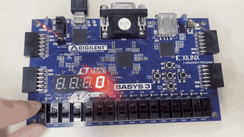
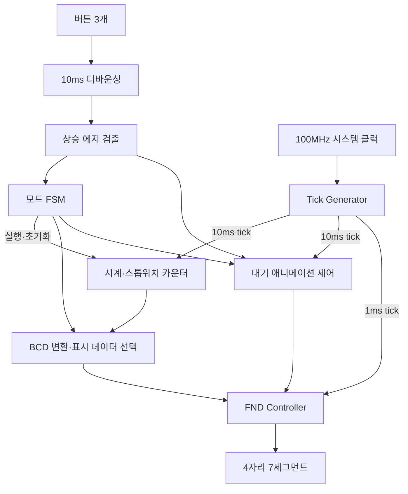
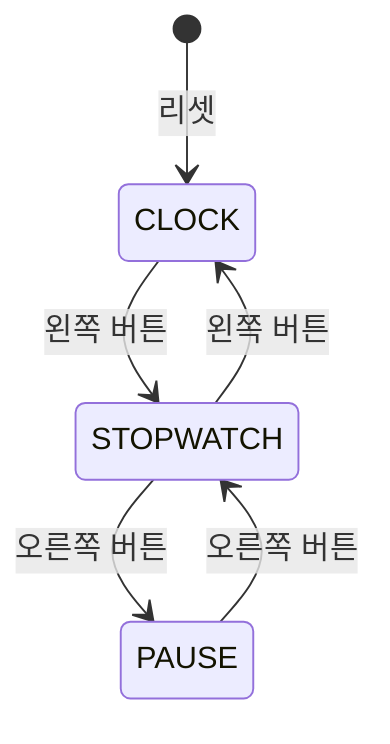

# ⏱️ Stopwatch — Basys3 FPGA 시계·스톱워치

Basys3 보드에서 **시계와 10ms 단위 스톱워치**를 구현한 Verilog HDL 프로젝트입니다. 버튼으로 모드 전환, 초기화, 일시정지·재개를 제어하고, 일시정지 상태에서는 대기 시간에 따라 7세그먼트 애니메이션을 표시합니다.

버튼 입력 처리부터 시간 계측, 상태 전환, FND 출력까지 RTL로 구성하고, 각 기능을 독립된 모듈로 분리했습니다.

[← 포트폴리오](../README.md)

## 🎬 동작 영상



[원본 영상 보기](./assets/basys3.mp4)

---

## 🔧 기술 스택

| 분류 | 내용 |
|---|---|
| 보드 | Basys3 |
| FPGA | Artix-7 `xc7a35tcpg236-1` |
| 언어 / 도구 | Verilog HDL / Vivado 2020.2 |
| 시스템 클럭 | 100MHz |
| 입력 | 버튼 3개, 리셋 스위치(SW15) |
| 출력 | 4자리 7세그먼트(FND) |
| 핵심 설계 | FSM, 디바운싱, 상승 에지 검출, tick 생성, BCD 변환, 멀티플렉싱 |

## ✨ 주요 기능

| 기능 | 동작 |
|---|---|
| 시계 | 리셋 후 경과 시간을 `MM.SS`로 표시, `59.59` 이후 `00.00`으로 순환 |
| 스톱워치 | 10ms 단위로 계측해 `SS.CC`로 표시, `59.99` 이후 순환 |
| 일시정지·재개 | 측정값을 유지하고 재개 시 이어서 계측 |
| 스톱워치 초기화 | 실행 중 가운데 버튼을 누르면 측정값을 `00.00`으로 초기화 |
| 구분점 표시 | 시계 모드에서 1초마다 점등 상태 반전, 스톱워치에서는 항상 점등 |
| 대기 애니메이션 | 일시정지 후 5초간 입력이 없으면 FND 외곽을 따라 순환 표시 |

시계는 모든 모드에서 계속 시간을 세고, 스톱워치는 실행 상태에서만 증가합니다. 스톱워치에서 시계로 전환해도 측정값을 유지하므로 다시 스톱워치로 돌아오면 이어서 계측할 수 있습니다.

## 🎛️ 조작 방법

| 입력 | 동작 |
|---|---|
| 왼쪽 버튼 | 시계 ↔ 스톱워치 실행 모드 전환 |
| 가운데 버튼 | 스톱워치 실행 중 측정값 초기화 |
| 오른쪽 버튼 | 스톱워치 일시정지 ↔ 재개 |
| SW15 ON | 전체 초기화 및 시계 모드 진입 |

사용을 시작할 때 SW15를 ON으로 올려 초기화한 뒤 OFF로 내려 리셋을 해제합니다. 일시정지 중에는 오른쪽 버튼으로 계측을 재개합니다. 애니메이션이 표시되는 동안 버튼을 누르면 애니메이션이 해제됩니다.

## 📐 시스템 구조



### 1. 버튼 입력 — 디바운싱과 에지 검출

물리 버튼의 채터링으로 상태가 여러 번 바뀌는 것을 막기 위해 입력 변화가 약 10ms 동안 유지될 때 버튼 상태를 갱신합니다. 이후 현재 입력과 이전 클럭의 입력을 비교해 **버튼을 누르는 순간 한 클럭 펄스**를 생성합니다.

```verilog
assign btn_pulse = clean_btn & ~prev_btn;
```

버튼을 길게 누르더라도 FSM에는 한 번의 입력으로 전달됩니다.

### 2. FSM — 상태 전환과 계측 제어

모드 제어를 `CLOCK`, `STOPWATCH`, `PAUSE`의 세 상태로 나누었습니다. 상태 레지스터, 다음 상태 조합 논리, 출력 논리를 분리하고, 현재 상태로부터 스톱워치 실행 신호를 생성합니다.



가운데 버튼은 `STOPWATCH` 상태에서 초기화 신호를 발생시킵니다. `PAUSE` 상태에서는 측정값을 그대로 유지합니다.

### 3. 시간 계측 — 단일 클럭과 주기별 tick

모든 순차 회로는 100MHz 시스템 클럭으로 동작하고, 필요한 주기마다 한 클럭 폭의 tick을 생성해 카운터 갱신과 표시 스캔을 제어합니다.

| Tick | 생성 주기 | 사용처 |
|---|---|---|
| `tick_10ms` | 1,000,000클럭 / 10ms | 스톱워치, 시계, 구분점, 애니메이션 |
| `tick_1ms` | 100,000클럭 / 1ms | FND 자릿수 스캔 |

시계는 10ms tick 100회를 1초로 환산하고, 초·분을 각각 0~59까지 계수합니다. 스톱워치는 실행 신호가 활성화된 동안 0~99의 센티초와 0~59의 초를 계수합니다.

### 4. FND — BCD 변환과 멀티플렉싱

시간 카운터의 값을 나눗셈과 나머지 연산으로 십의 자리·일의 자리로 변환한 뒤, 모드에 따라 시계 또는 스톱워치의 4자리 BCD 데이터를 선택합니다.

FND 컨트롤러는 1ms마다 표시 자리를 바꾸고, 선택한 자리의 숫자를 Active-low 세그먼트 패턴으로 출력합니다. 네 자리를 4ms 주기로 순환하며 숫자와 소수점을 함께 제어합니다.

### 5. 대기 애니메이션 — 시간 계측과 표시 제어 분리

`PAUSE` 상태에서 10ms tick을 500회 세면 대기 애니메이션을 시작합니다. 네 자리 FND의 위쪽 → 오른쪽 → 아래쪽 → 왼쪽 외곽을 따라 **100ms마다 다음 단계로 이동**하고, 12단계를 반복합니다.

애니메이션은 FND 출력 패턴만 변경하므로 정지된 측정값은 유지됩니다. 버튼 입력이나 모드 전환이 발생하면 대기 카운터와 애니메이션 상태를 초기화합니다.

## 📍 하드웨어 핀맵

| 신호 | Basys3 핀 | 용도 |
|---|---|---|
| `clk` | W5 | 100MHz 클럭 |
| `reset` | R2 | SW15, Active-high 리셋 |
| `btn[0]` | W19 | 왼쪽 버튼 |
| `btn[1]` | U18 | 가운데 버튼 |
| `btn[2]` | T17 | 오른쪽 버튼 |
| `seg[0:6]` | W7, W6, U8, V8, U5, V5, U7 | 세그먼트 a~g |
| `seg[7]` | V7 | 소수점 |
| `an[0:3]` | U2, U4, V4, W4 | FND 자릿수 선택 |

## 📂 코드 구성

| 파일 | 역할 |
|---|---|
| `top.v` | 모듈 연결, BCD 변환, 표시 데이터 선택, 구분점 제어 |
| `button_debounce_10ms.v` | 버튼 3개의 디바운싱 |
| `button_edge.v` | 버튼 상승 에지 검출 |
| `mode_controller.v` | 모드 FSM 및 실행·초기화 신호 생성 |
| `tick_generator.v` | 파라미터로 주파수를 지정하는 tick 생성기 |
| `time_counter.v` | 시계·스톱워치 시간 계측 |
| `ani_controller.v` | 일시정지 대기 시간 및 애니메이션 단계 제어 |
| `fnd_controller.v` | 자릿수 스캔, 숫자 디코딩, 애니메이션 출력 |

RTL은 `stopwatch.srcs/sources_1/`, 핀 제약은 `stopwatch.srcs/constrs_1/`, 테스트벤치는 `stopwatch.srcs/sim_1/`에 있습니다.

## 🧪 시뮬레이션 구성

tick 생성, 버튼 펄스, 모드 전환을 각각 관찰할 수 있도록 테스트벤치를 구성했습니다.

| 테스트벤치 | 시나리오 |
|---|---|
| `tb_tick_generator` | 작은 분주 파라미터를 적용해 주기적인 tick 출력 관찰 |
| `tb_button_edge` | 각 버튼을 여러 클럭 동안 유지하며 상승 에지 펄스 관찰 |
| `tb_stopwatch` | 모드 FSM의 시계 → 스톱워치 → 초기화 → 일시정지 → 재개 → 시계 전환 |

Vivado에서 테스트벤치를 **Set as Top**으로 지정한 뒤 **Run Behavioral Simulation**을 실행하면 해당 모듈의 파형을 확인할 수 있습니다.

## 🚀 실행 방법

1. Vivado에서 [stopwatch.xpr](./stopwatch.xpr)을 엽니다.
2. 설계 Top 모듈을 `top`으로 설정합니다.
3. **Run Synthesis → Run Implementation → Generate Bitstream**을 실행합니다.
4. Basys3를 USB로 연결하고 **Hardware Manager → Open Target → Auto Connect**를 선택합니다.
5. **Program Device**에서 생성한 비트스트림을 다운로드합니다.
6. SW15로 초기화한 뒤 버튼으로 시계·스톱워치를 조작합니다.
